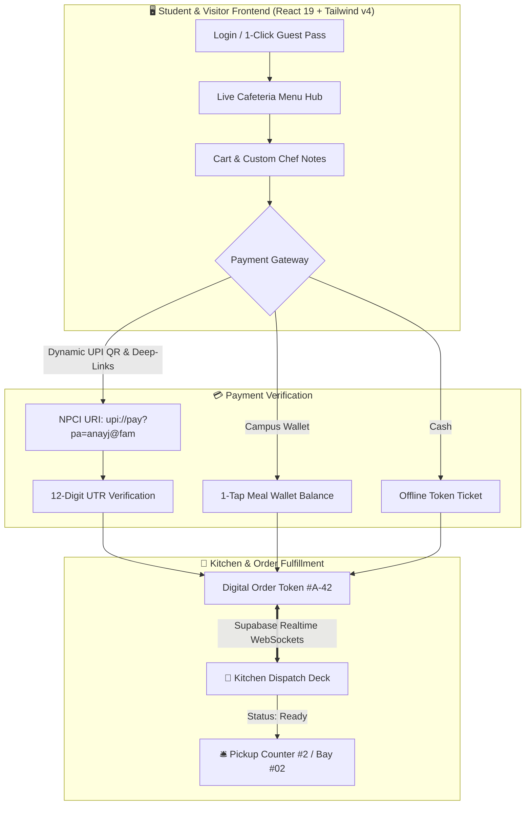

<div align="center">

# ⚡ BYTE // CANTEEN
### High-Velocity Campus Food Ordering & Digital Token Platform
**Engineering Block C · Don Bosco Institute of Technology (DBIT)**

[](https://react.dev/)
[](https://vitejs.dev/)
[](https://tailwindcss.com/)
[](https://supabase.com/)
[](DESIGN.md)
[](LICENSE)

<br/>

> **"SKIP THE QUEUE. NOT THE LECTURE."**  
> *Pre-order canteen meals between lectures, skip the 30-minute rush, and collect fresh food at Counter #2 in under 180 seconds.*

<br/>

[**Explore Features**](#-key-features) • [**Architecture**](#-system-architecture) • [**Quick Start**](#-quick-start) • [**Design System**](#-neo-brutalist-design-system) • [**Database**](#-database--backend-setup)

---

</div>

<br/>

## 🌟 At a Glance

| Feature | Description | Status |
| :--- | :--- | :---: |
| ⚡ **Instant Guest Pass** | 1-Click access without passwords; pre-loaded ₹500 test wallet | ✅ Production Ready |
| 🎓 **Campus Authentication** | Student Moodle `@dbit.in` login & faculty priority access | ✅ Production Ready |
| 🍛 **Live Menu Matrix** | Real-time stock counters, dietary badges, search & category filters | ✅ Production Ready |
| 📱 **Dynamic UPI Gateway** | NPCI URI generator, on-the-fly QR code, 1-tap GPay / PhonePe / Paytm | ✅ Production Ready |
| 🛡️ **Anti-Fraud Security** | 12-digit UTR receipt validation preventing screenshot tampering | ✅ Production Ready |
| 🎫 **Boarding-Pass Tokens** | 72px high-visibility pickup vouchers (`#A-42`) with notch cutouts | ✅ Production Ready |
| 🍳 **Kitchen Command Deck** | Live staff Kanban stream with real-time status progression | ✅ Production Ready |

<br/>

---

## 🏗️ System Architecture



<br/>

---

## 🎨 Neo-Brutalist Design System

The platform's visual identity blends **Editorial Neo-Brutalism** with **Clean-Tech Utilitarianism**, engineered for instant readability in loud, fast-paced campus environments.

### 🎨 Color Palette

| Swatch | Role | Hex Code | Token Name | Application |
| :---: | :--- | :---: | :--- | :--- |
|  | **Primary Accent** | `#C8FF00` | `cyber-lime` | Main CTAs, Add-to-Cart, active order states |
|  | **Midnight Obsidian** | `#121316` | `obsidian` | 1.5px structural borders, hard shadows, headings |
|  | **Electric Cobalt** | `#3B5BDB` | `cobalt` | Real-time timers, queue tokens, ETA chips |
|  | **Warm Oat Cream** | `#F6F5F0` | `oat` | Low-glare canvas base, ticket backdrops |
|  | **Pure Veg** | `#059669` | `veg` | Green circular dietary symbol |
|  | **Non-Veg** | `#DC2626` | `non-veg` | Red triangular dietary symbol |

### 📐 Physical Depth & Typography
- **Hard Drop Shadows**: `4px 4px 0px #121316` (active states collapse to `1px 1px 0px #121316`).
- **Typography Pairing**:
  - **Space Grotesk (700)** — High-impact headings, order tokens (`#A-42`), and currency figures.
  - **Inter (400/500/600)** — Clinical legibility for nutrition labels, ingredient notes, and UTR numbers.

<br/>

---

## ⚡ Key Features Walkthrough

### 1. Multi-Tier Campus Authentication
- **Student Moodle Login**: Secure credentials validation with auto-completed `@dbit.in` domain.
- **Faculty Lounge**: Priority queue routing for teaching and departmental staff.
- **Instant Guest Pass**: One-touch entry granting immediate access to the full menu, persistent cart, and order generation with ₹500 test credit.

### 2. Live Cafeteria Ordering Hub (`/`)
- **Fast-Filter Category Pills**: Breakfast, Mains, Snacks, Beverages, and Desserts.
- **Stock Telemetry**: Dynamic tags display stock levels (*"Only 18 left"*), chef specials, and estimated preparation time.
- **Responsive Drawer Cart**: Real-time quantity steppers syncing instantly between desktop sidebars and mobile drawers.

### 3. Dynamic UPI Payment & Anti-Fraud Suite (`/checkout`)
- **NPCI Standard UPI Intent**: Automatically constructs:
  ```
  upi://pay?pa=anayj@fam&pn=DBIT%20Campus%20Canteen&am=85.00&tr=DBIT984210&cu=INR
  ```
- **Live Vector QR Code**: Rendered in crisp SVG format via `qrcode.react`, locking in the exact order amount so students cannot alter prices.
- **1-Tap Mobile Triggers**: Direct application switching for **GPay**, **PhonePe**, and **Paytm**.
- **12-Digit UTR Verification**: Requires receipt transaction reference before voucher issuance (with an auto-fill simulation button for frictionless testing).

### 4. Boarding-Pass Token & Live Tracker (`/order/:orderId`)
- Styled like an engineered boarding pass with perforated punch-hole cutouts.
- Jumbo **72px Token Numbers** legible across crowded cafeterias.
- Live 4-step progress radar:
  $$\text{Confirmed} \longrightarrow \text{🔥 Preparing} \longrightarrow \text{✅ Ready for Pickup} \longrightarrow \text{📦 Collected}$$

### 5. Staff Dispatch Command Deck (`/kitchen`)
- Real-time queue view for kitchen staff with automatic sound alerts for new tickets.
- Fast status cycle buttons to keep queue delays under 3 minutes.
- Live kitchen workload telemetry (Low / Medium / High rush).

<br/>

---

## 📂 Repository Structure

```
DBIT Canteen/
├── public/                      # Static assets & favicon icons
├── screens/                     # Original 11 Google Stitch design exports
│   ├── 01-desktop-student-login.html
│   ├── 03-desktop-live-menu-hub.html
│   ├── 06-desktop-payment-checkout.html
│   ├── 08-desktop-order-tracker.html
│   └── 11-interactive-fast-track-flow.html
├── src/
│   ├── components/              # Neo-Brutalist UI Component Library
│   │   ├── ui.jsx               # Button, Card, Badge, DietBadge, LivePulse, Spinner
│   │   ├── Navbar.jsx           # Top branding bar with live order pulse & cart count
│   │   ├── MenuItemCard.jsx     # Food discovery cards with quantity counter
│   │   ├── ProtectedRoute.jsx   # Auth route wrapper
│   │   └── KitchenRoute.jsx     # Staff route gatekeeper
│   ├── lib/
│   │   ├── supabase.js          # Resilient Supabase client
│   │   ├── mockData.js          # Offline seed menu & fallback items
│   │   └── utils.js             # Currency formatting & status badge helpers
│   ├── pages/
│   │   ├── LoginPage.jsx        # Login, faculty portal & Guest Fast-Track
│   │   ├── MenuPage.jsx         # Live menu catalog & search matrix
│   │   ├── CheckoutPage.jsx     # Dynamic UPI QR, 1-tap apps & UTR verification
│   │   ├── OrderTrackerPage.jsx # Boarding-pass token & live progress radar
│   │   ├── KitchenDashboard.jsx # Real-time staff dispatch Kanban
│   │   └── NotFoundPage.jsx     # Neo-brutalist 404 handler
│   ├── store/
│   │   ├── authStore.js         # Zustand auth store (Supabase + Guest fallback)
│   │   └── cartStore.js         # Zustand cart store with localStorage sync
│   ├── App.jsx                  # React Router routes & QueryClient setup
│   ├── index.css                # Tailwind v4 theme, fonts & brutal classes
│   └── main.jsx
├── .env.local                   # Environment variables (Supabase & UPI ID)
├── DESIGN.md                    # Formal Neo-Brutalist specification sheet
├── package.json                 # Project dependencies & scripts
├── supabase-schema.sql          # PostgreSQL DDL, RLS policies, sequences & seeds
└── vite.config.js               # Vite 8 config with @tailwindcss/vite
```

<br/>

---

## 🚀 Quick Start

### 1. Prerequisites
- **Node.js** `v18.0.0` or higher (`v24.x` recommended)
- **npm** `v9.x` or higher

### 2. Installation
```powershell
# Navigate to the project root
cd "D:\Anay\CODES\DBIT Canteen"

# Install dependencies
npm install
```

### 3. Environment Setup
Your `.env.local` is pre-configured with test values:
```env
VITE_SUPABASE_URL=https://your-project.supabase.co
VITE_SUPABASE_PUBLISHABLE_KEY=your-supabase-anon-key
VITE_CANTEEN_UPI_ID=anayj@fam
```

### 4. Run Development Server
```powershell
npm run dev
```
Open **[http://localhost:5173](http://localhost:5173)** in your browser.

<br/>

---

## 🗄️ Database & Backend Setup

The application features full Supabase PostgreSQL integration with automated fallback to an offline demo mode if database connectivity is unavailable.

<details>
<summary><b>Click to expand Supabase Setup Instructions</b></summary>
<br/>

1. Create a free project at [supabase.com](https://supabase.com).
2. Navigate to **SQL Editor** in your Supabase dashboard.
3. Paste the contents of [`supabase-schema.sql`](supabase-schema.sql) and execute:
   - Sets up `profiles`, `categories`, `menu_items`, `orders`, and `order_items` tables.
   - Creates the cycling token generator sequence (`#A-01` to `#Z-99`).
   - Seeds authentic canteen dishes (Vada Pav, Crispy Paneer Roll, Dum Biryani, etc.).
   - Enables Realtime replication on `orders` and `order_items`.
4. Copy your **Project URL** and **Anon / Publishable Key** into `.env.local`.

</details>

<br/>

---

## 🛠️ Tech Stack

<div align="center">

| Layer | Technology | Key Highlights |
| :--- | :--- | :--- |
| **Frontend Framework** | **React 19** | Component-driven architecture, fast state hooks |
| **Build & Bundler** | **Vite 8** | Sub-second HMR (~400ms startup), optimized Rolldown builds |
| **CSS & Design** | **Tailwind CSS v4** | CSS-first `@theme` configuration, zero runtime |
| **State Management** | **Zustand** | Multi-store architecture with automatic `localStorage` sync |
| **Server State** | **TanStack Query v5** | Automatic background re-validation and optimistic caching |
| **Database & Realtime** | **Supabase (PostgreSQL)** | RLS security, Postgres triggers, WebSocket broadcasts |
| **Payment Tooling** | **qrcode.react** | Clean SVG dynamic QR code generation |
| **Icons & Alerts** | **Lucide React + Hot Toast** | High-contrast brutalist notifications |

</div>

<br/>

---

## 📜 NPM Scripts

| Command | Action |
| :--- | :--- |
| `npm run dev` | Starts the Vite local development server on port `5173` |
| `npm run build` | Compiles an optimized production build in `/dist` |
| `npm run preview` | Spins up a local static server to preview the `/dist` build |

<br/>

---

<div align="center">

**Byte Canteen** · Don Bosco Institute of Technology (DBIT), Mumbai  
Designed & Engineered with Neo-Brutalist Precision

</div>
