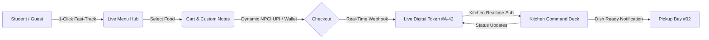

# ⚡ BYTE CANTEEN — DBIT Campus Fast-Track Platform

[](https://react.dev/)
[](https://vitejs.dev/)
[](https://tailwindcss.com/)
[](https://supabase.com/)
[](DESIGN.md)

> **"SKIP THE QUEUE. NOT THE LECTURE."**  
> A high-velocity campus food pre-ordering, digital token queuing, and kitchen dispatch system engineered for Don Bosco Institute of Technology (DBIT).

---

## 📸 Overview & Architecture

Byte Canteen eliminates the 30-minute cafeteria rush between classes. Students can order hot food, pay via dynamic UPI, and pick up fresh meals at Counter #2 in under 180 seconds using real-time digital boarding-pass tokens.



---

## ✨ Key Features

### 1. 🎨 Neo-Brutalist Design System
- Built from verified **Google Stitch** architectural templates (`projects/14802651670070316210`).
- **Tactile Palette**: Electric Cyber Lime (`#C8FF00`), Midnight Obsidian (`#121316`), Cobalt Blue (`#3B5BDB`), and Warm Oat Cream (`#F6F5F0`).
- **Typography**: Space Grotesk (700 bold headlines, token numbers, and prices) paired with Inter (high-density body copy).
- **Physical Depth**: Sharp 1.5px ink strokes, zero-blur hard offset shadows (`4px 4px 0px #121316`), and boarding-pass notch cutouts.

### 2. 🔐 Flexible Authentication & Guest Fast-Track
- **🎓 Student Moodle Access**: Authenticate via `@dbit.in` campus email and password.
- **🪪 Faculty & Guest Portal**: Dedicated portal for teachers and laboratory staff.
- **⚡ 1-Click Instant Guest Pass**: Instant access with zero credentials required — perfect for guests, campus visitors, or quick demos with pre-loaded ₹500 test wallet balance.
- **🌐 Google Workspace OAuth**: Direct single-sign-on integration.

### 3. 🍽️ Live Food Discovery & Smart Cart
- Real-time stock counters (e.g. *Only 18 left*) and kitchen prep estimates.
- Category filters: **Breakfast**, **Mains**, **Snacks**, **Beverages**, and **Desserts**.
- Dietary safety badges: High-contrast **Pure Veg** vs **Non-Veg** geometric indicators.
- In-memory & local-storage synced persistent cart with fluid increment/decrement steppers.

### 4. 💳 Dynamic UPI & Anti-Fraud Checkout
- **NPCI Dynamic UPI Intent**: Encodes order ID, exact amount, and payee VPA into a standard `upi://pay` URI so students cannot alter payment amounts.
- **Dynamic QR Code**: High-resolution SVG QR code generated on the fly via `qrcode.react`.
- **1-Tap Mobile Triggers**: One-touch launchers for **Google Pay**, **PhonePe**, and **Paytm**.
- **Anti-Fraud UTR Verification**: Requires 12-digit UPI Transaction Reference (with 1-click test simulation).
- **DBIT Campus Wallet**: Instant 1-tap deduction with zero bank network lag during rush hours.
- **Cash at Counter**: Generates token with deferred cash payment terms.

### 5. 🎫 Boarding-Pass Digital Order Token
- High-visibility 72px pickup token numbers (e.g. `#A-42`) legible from across a crowded dining hall.
- Real-time progress timeline: **Order Confirmed ➔ Kitchen Preparing ➔ Ready for Pickup ➔ Order Collected**.
- Designated pickup bay alerts (e.g. `BAY #02`).

### 6. 🍳 Live Kitchen Dispatch Dashboard (`/kitchen`)
- Real-time order Kanban stream powered by Supabase Realtime WebSocket events.
- Audio and visual toast alerts for incoming orders.
- 1-click order state advances: **Confirm Order ➔ Start Preparing ➔ Mark Ready ➔ Mark Collected**.
- Real-time operational metrics for kitchen load balancing.

---

## 🗂️ Project File Structure

```
DBIT Canteen/
├── public/                 # Static assets & brand graphics
├── screens/                # Original 11 Stitch HTML/CSS source screens
│   ├── 01-desktop-student-login.html
│   ├── 02-mobile-student-login.html
│   ├── 03-desktop-live-menu-hub.html
│   ├── 06-desktop-payment-checkout.html
│   ├── 08-desktop-order-tracker.html
│   └── ...
├── src/
│   ├── components/         # Reusable Neo-Brutalist UI components
│   │   ├── ui.jsx          # Button, Card, Badge, DietBadge, LivePulse, Spinner
│   │   ├── Navbar.jsx      # Top brand nav with live order indicator & cart count
│   │   ├── MenuItemCard.jsx# Menu item cards with inline quantity stepper
│   │   ├── ProtectedRoute.jsx
│   │   └── KitchenRoute.jsx
│   ├── lib/
│   │   ├── supabase.js     # Supabase client with flexible anon/publishable key support
│   │   ├── mockData.js     # Offline fallback menu items & categories
│   │   └── utils.js        # Formatting helpers & order badge color maps
│   ├── pages/
│   │   ├── LoginPage.jsx   # Neo-brutalist authentication & Guest Fast-Track
│   │   ├── MenuPage.jsx    # Menu catalog, real-time filters & search
│   │   ├── CheckoutPage.jsx# Dynamic UPI QR, 1-tap apps & UTR verification
│   │   ├── OrderTrackerPage.jsx # Boarding-pass order ticket & live progress
│   │   ├── KitchenDashboard.jsx # Real-time staff order queue & status dispatcher
│   │   └── NotFoundPage.jsx
│   ├── store/
│   │   ├── authStore.js    # Zustand auth store (Supabase + local guest fallback)
│   │   └── cartStore.js    # Zustand cart store with localStorage persistence
│   ├── App.jsx             # React Router routing & React Query setup
│   ├── index.css           # Tailwind v4 theme, fonts & brutal utility classes
│   └── main.jsx
├── .env.local              # Local environment configuration
├── DESIGN.md               # Full Neo-Brutalist design specifications & token specs
├── package.json            # Node project configuration & dependencies
├── supabase-schema.sql     # PostgreSQL database schema, RLS policies & seed data
└── vite.config.js          # Vite build config with Tailwind v4 plugin
```

---

## 🚀 Getting Started

### Prerequisites
- **Node.js**: `v18.0.0` or later (`v24.x` recommended)
- **npm**: `v9.x` or later

### Installation

1. Clone or navigate to the project directory:
   ```bash
   cd "D:\Anay\CODES\DBIT Canteen"
   ```

2. Install dependencies:
   ```bash
   npm install
   ```

3. Configure Environment Variables in `.env.local`:
   ```env
   VITE_SUPABASE_URL=https://your-project.supabase.co
   VITE_SUPABASE_PUBLISHABLE_KEY=your-supabase-anon-key
   VITE_CANTEEN_UPI_ID=anayj@fam
   ```

4. Launch the local development server:
   ```bash
   npm run dev
   ```
   Open **[http://localhost:5173](http://localhost:5173)** in your browser.

---

## 🗄️ Database Setup (Supabase)

1. Create a project at [supabase.com](https://supabase.com).
2. Open the **SQL Editor** in your Supabase dashboard.
3. Paste the contents of [`supabase-schema.sql`](supabase-schema.sql) and run it.
4. This script automatically:
   - Creates `profiles`, `categories`, `menu_items`, `orders`, and `order_items` tables.
   - Configures automated Row Level Security (RLS) policies.
   - Sets up the auto-cycling token generator sequence (`#A-01` to `#Z-99`).
   - Populates initial menu seed data (Mumbai Vada Pav, Crispy Paneer Roll, Dum Biryani, etc.).
   - Enables Realtime publications for live order tracking.

> **Note:** The application features built-in graceful fallbacks. If Supabase is not connected or offline, the app runs in **Offline Demo Mode** with full cart, menu, and token simulation.

---

## 🛠️ Tech Stack & Libraries

| Technology | Purpose |
| :--- | :--- |
| **React 19** | Component-driven UI runtime |
| **Vite 8** | Ultra-fast build tool and HMR server |
| **Tailwind CSS v4** | Utility-first styling & custom design tokens |
| **Zustand** | Lightweight client state (Cart & Auth session) |
| **TanStack React Query** | Asynchronous data fetching & automatic cache invalidation |
| **Supabase JS** | PostgreSQL backend, auth provider & Realtime WebSockets |
| **qrcode.react** | Dynamic NPCI-compliant vector UPI QR code generator |
| **Lucide React** | Clean, accessible SVG iconography |
| **React Hot Toast** | Brutalist notification toast toasts |

---

## 📜 Available Scripts

- `npm run dev` — Starts the local development server at `http://localhost:5173`.
- `npm run build` — Builds the optimized production bundle in `/dist`.
- `npm run preview` — Locally previews the production build.

---

## 👨‍💻 Author & Maintainers
- Developed for **Don Bosco Institute of Technology (DBIT)** Main Cafeteria.
- Design architecture exported and customized via **Google Stitch**.
# DBIT-Canteen

